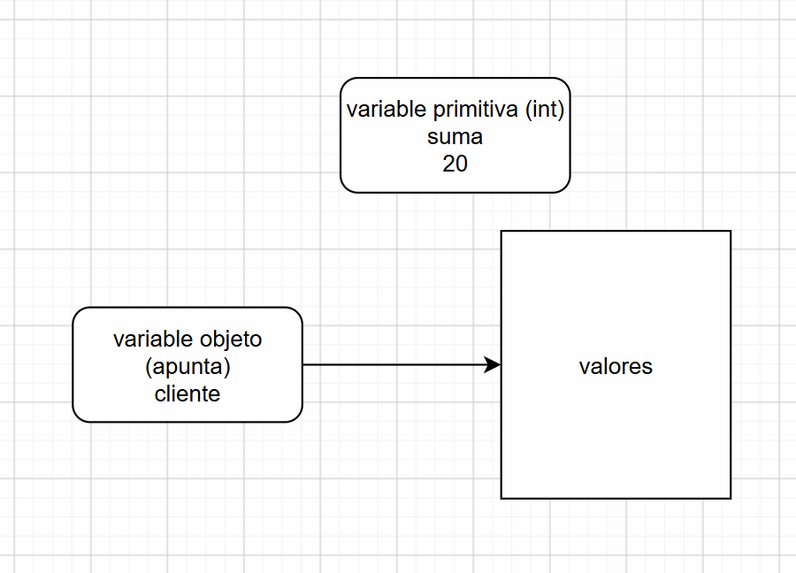

# nota 2026 11 09

## Java

## nombres de cosas

* variable: se inicia en minuscula: ejemplo `miVariable`
   * una variable con dos objetos o nombres se usa el formato del camello: ejemplo `miVariableCompuesta`. No se recomienda mi_variable.
   * Una variable se refiere a estados o valores
* clase: se inicia en mayuscula: ejemplo `MiClase`
* constante: se escribe en mayusculas con guiones bajos entre palabras: ejemplo `MI_CONSTANTE`
* funcion: se inicia en minuscula y usa el formato del camello: ejemplo `miFuncion()`. Una funcion usualmente se refiere a un verbo o accion.

### variables
En jaqva las variables son espacio de memoria donde se dejan valores.
Se deben declarar con un tipo de dato antes de usarlas. Por ejemplo:

```java
int numero = 5;
String texto = "Hola";
boolean esVerdadero = true;
```
### tipos de datos

En Java, los tipos de datos definen el tipo de valor que una variable puede almacenar. Algunos tipos de datos comunes son:

- `int`: para números enteros ( menos 2 mil millones a 2 mil millones aprox. ) 4 byte
- `double`: para números con decimales.
- `boolean`: para valores verdadero o falso.
- `String`: para cadenas de texto.
- `char`: para un solo carácter.
- `float`: para números con decimales de precisión simple. (coma flotante) FPU <-- no es tan preciso como `double`.   0.1+0.1 = 0.2  0.199999999999999
- `long`: para números enteros grandes. (menos 9 quintillones a 9 quintillones aprox.)  8 byte
- `short`: para números enteros pequeños. (menos 32 mil a 32 mil aprox.) 2 byte
- `byte`: para números enteros muy pequeños. (menos 128 a 127 aprox.) 1 byte

```java
int edad=25;
long numeroGrande = 9000000000L;
String texto = "Hola 20 303030 3 !!$";
char caracter = 'A';
String caracter ="A";
```
> Java hace una diferencia. "10" es un `String`, mientras que 10 es un `int`.

### bloque de codigo
Los bloques de codigo usualmente se escriben entre llaves {}

```java
{ // <-- inicio
    int numero = 10; // declaración de una variable dentro del bloque
} // <-- fin del bloque
// aqui la variable numero no esta definida, ya que solo existe dentro del bloque

```
> Garbage Collector: JAVA usa el colector de basura.

### comentarios

En Java, los comentarios se utilizan para agregar notas o explicaciones dentro del código y no son ejecutados por el compilador. Hay dos tipos principales de comentarios:

- Comentarios de una sola línea: se escriben con `//`.
- Comentarios de múltiples líneas: se escriben entre `/*` y `*/`.

```java
// Este es un comentario de una sola línea
int numero = 10; /* Este es un comentario de múltiples líneas */
```
Ejemplo:

```java
/* el siguiente bloque de código calcula la suma de dos precios */
int precio1=10;
int precio2=20;
int sumaPrecio = precio1 + precio2;
```
### constante
Es un valor que no cambia.

```java
final int IVA=19;
```

### operaciones
En Java, se pueden realizar operaciones aritméticas utilizando operadores como `+`, `-`, `*`, `/` y `%`.

```java
int a = 10;
int b = 5;
int suma = a + b; // 15
int resta = a - b; // 5
int multiplicacion = a * b; // 50
int division = a / b; // 2
int modulo = a % b; // 0
int operaciones = (a+2)/b + (a*b); // 12 + 50 = 62
```
> Depende de los valores es lo que se va a obtener.

```java
int a=30;
int b=25;
int div1=a/b; // 1
double div2=a/b; // 1.0
double div3=(double)a/(double)b; // 1.2 <-- es un cast (no es una conversion)
```

### funciones
Una funcion es un bloque de codigo que hace alguna operacion. Se puede reutilizar en diferentes partes del programa y puede recibir parámetros y devolver un valor.

```java
int sumar(int a, int b) {
    return a + b;
}
```


#### ejemplo de prompt

```
crea una aplicacion de consola en java, que sume dos numeros y los muestre en la pantalla
```

Ejemplo de variables para un producto:
```java
String nombreProducto = "Laptop";
double precio = 1500.50;
int cantidad = 3;
```
### OOP
En Java se trabaja con el paradigma de Programación Orientada a Objetos (OOP, por sus siglas en inglés). Esto significa que el código se organiza en clases y objetos, donde las clases definen la estructura y el comportamiento de los objetos.

#### Que es una clase?
Una clase es una plantilla o modelo que define las propiedades (atributos) y comportamientos (métodos) que los objetos creados a partir de ella tendrán.

```java
class MiClase {
    // escribo el codigo de la clase aqui
}
```
#### Que es un objeto?

Es una variable definida por una clase.
Un objeto es una variable que guarda un puntero donde esta el valor.

```java
MiClase objeto1 = new MiClase();
// creo un objeto llamado objeto1
// new = crea una nueva instancia de la clase MiClase
// objeto1 apunta a ese espacio de memoria.
```
```java
MiClase objeto2; //esta variable esta definida pero no apunta a ningun objeto. NULL.
```


> Los objetos y las variables normales (primitivas) tienen diferencias.



### clase

```java
class Producto {
    // atributos o miembros de la clase Producto 
    // no es una variable, ya que esta a nivel de la clase.
    String nombre;
    // funciones o metodos
    void mostrarInformacion() {
    }
    // constructor  
    Producto(String nombre) {
        this.nombre = nombre;
    }
}
```

### namespaces/packages

ejemplo:
```java
// en un archivo llamado Cliente.java
package paquete1;

class Cliente { // paquete1.Cliente

}
// en un archivo llamado Cliente2.java
package paquete2;

class Cliente { // paquete2.Cliente

}

paquete1.Cliente obj=new paquete1.Cliente();
paquete2.Cliente obj2=new paquete2.Cliente();
```


