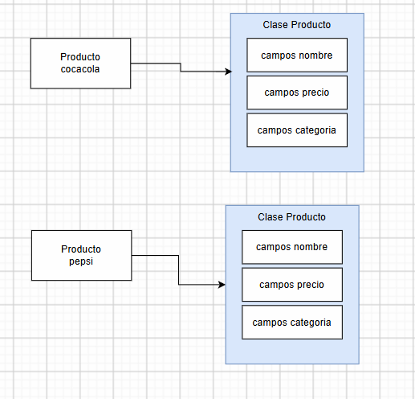

# Nota 2

* Producto: 
    * nombre: cocacola (String)
    * precio: 1.5 (double)
    * cantidad: 10 (int)
    * categoria: bebida (String)
* Producto:
    * nombre: pepsi (String)
    * precio: 1.2 (double)
    * cantidad: 15 (int)
    * categoria: bebida (String)

```java
String nombre = "cocacola";
double precio = 1.5;
int cantidad = 10;
String categoria = "bebida";
```
## pasos

* Crear una clase `Producto` con los atributos `nombre`, `precio`, `cantidad` y `categoria`.

```java
class Producto {
    private String nombre;
    private double precio;
    private int cantidad;
    private String categoria;    

    // Métodos getter y setter para los atributos privados

    public String getNombre() {
        return nombre;
    }
    public double getPrecio() {
        return precio;
    }
    public int getCantidad() {
        return cantidad;
    }
    public String getCategoria() {
        return categoria;
    }

    public void setNombre(String nombre) {
        this.nombre = nombre;
    }
    
    public void setPrecio(double precio) {
        this.precio = precio;
    }
    
    public void setCantidad(int cantidad) {
        this.cantidad = cantidad;
    }
    
    public void setCategoria(String categoria) {
        this.categoria = categoria;
    }
}

Producto cocacola=new Producto();
cocacola.setNombre("cocacola");
cocacola.setPrecio(1.5);
cocacola.setCantidad(10);
cocacola.setCategoria("bebida");

System.out.println(cocacola.getNombre()); // cocacola
System.out.println(cocacola.getPrecio()); // 1.5
System.out.println(cocacola.getCantidad()); // 10
System.out.println(cocacola.getCategoria()); // bebida

Producto pepsi=new Producto();
pepsi.setNombre("pepsi");
pepsi.setPrecio(1.2);
pepsi.setCantidad(15);
pepsi.setCategoria("bebida");

```



## tipos de clases

* La clase que define un tipo de datos (ejemplo, una clase que tiene campos, setter/getter o constructor), se llama MODELO.
    * Una clase de modelo, es una clase para definir datos.
* Si la clase de modelo ademas tiene que ver con persistencia (base de datos), se llama ENTIDAD.

## constructor

```java
class Producto {
    private String nombre;
    private double precio;
    private int cantidad;
    private String categoria;    
    // constructor
    Producto(String nombre, double precio, int cantidad, String categoria) {
        this.nombre = nombre;
        this.precio = precio;
        this.cantidad = cantidad;
        this.categoria = categoria;
    }
    Producto() {
        // Constructor por defecto
    }
    Producto(String nombre) {
        this.nombre = nombre;
    }
}

Producto prod=new Producto("cocacola", 1.5, 10, "bebida");
Producto prod2=new Producto();
Producto prod3=new Producto("cocacola");
```